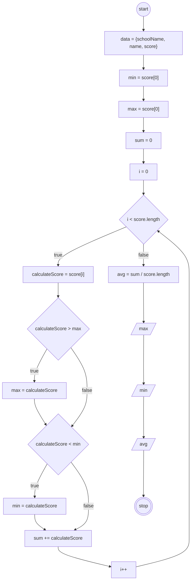

# JavaScript 4

## Program Hitung Nilai

### Flowchart



### Kode
```javascript
const data = {
    schoolName: 'SMK Negeri 2 Kota Bekasi',
    name: ['Diana', 'Bayu', 'Budi'],
    score: [56, 78, 45]
};

data.name = [...data.name, 'Feri', 'Sarah', 'Dini', 'Rima'];
data.score = [...data.score, 95, 87, 76, 92];

let min = data.score[0];
let max = data.score[0];
let sum = 0;

for (let i = 0; i < data.score.length; i++) {
    let calculateScore = data.score[i];
    if (calculateScore > max) {
        max = calculateScore;
    }
    if (calculateScore < min) {
        min = calculateScore;
    }
    sum += calculateScore;
}
let avg = sum / data.score.length;

console.log("Nilai Tertinggi (Max):", max);
console.log("Nilai Terendah (Min):", min);
console.log("Rata-rata (Avg):", avg);
```